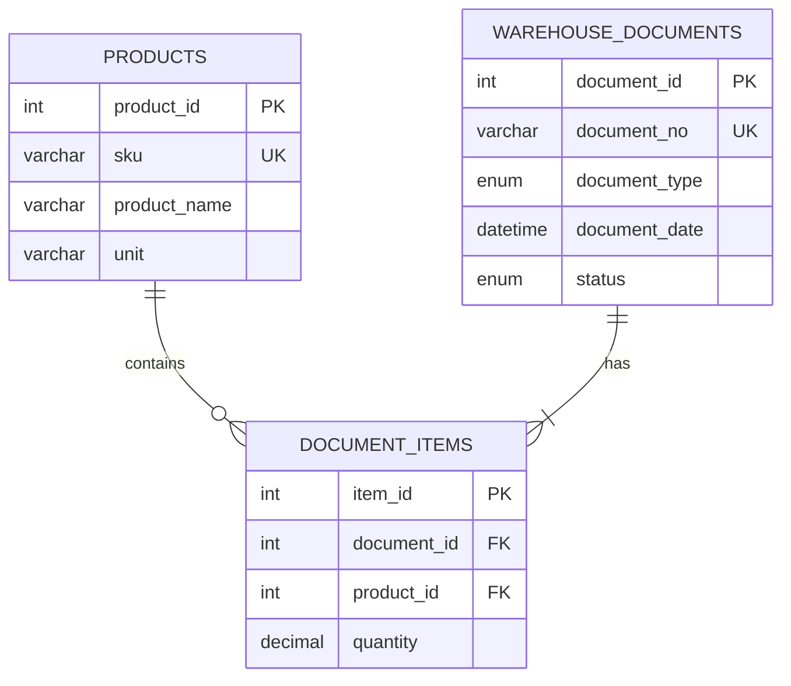

# L08 — Өгөгдлийн сангийн загвар (Database Design)

## 1. Зорилго

Агуулахын системд барааны мэдээлэл, орлого, зарлага болон баримтын мэдээллийг хадгалах өгөгдлийн сангийн загвар гаргав.

Өгөгдлийн сан нь барааны SKU давхардахгүй байх, тоо хэмжээ 0 болон сөрөг утгатай болохоос хамгаалах, үлдэгдлийг зөв тооцоолох шаардлагатай.

## 2. Өгөгдлийн сангийн нэр

`warehouse_db`

## 3. Хүснэгтүүд

Энэ системд дараах 3 үндсэн хүснэгт ашиглана.

### 3.1 products — Барааны мэдээлэл

| Багана | Төрөл | Тайлбар |
|---|---|---|
| product_id | INT | Барааны давтагдашгүй ID |
| sku | VARCHAR(50) | Барааны код |
| product_name | VARCHAR(150) | Барааны нэр |
| unit | VARCHAR(30) | Хэмжих нэгж |
| created_at | DATETIME | Үүсгэсэн огноо |

`sku` талбарт UNIQUE constraint ашиглана. Ингэснээр ижил SKU-тай бараа давхар бүртгэгдэхгүй.

### 3.2 warehouse_documents — Орлого, зарлагын баримт

| Багана | Төрөл | Тайлбар |
|---|---|---|
| document_id | INT | Баримтын ID |
| document_no | VARCHAR(50) | Баримтын дугаар |
| document_type | ENUM | IN эсвэл OUT |
| document_date | DATETIME | Баримтын огноо |
| status | ENUM | DRAFT эсвэл CONFIRMED |
| note | VARCHAR(255) | Нэмэлт тайлбар |

`IN` нь барааны орлого, `OUT` нь барааны зарлагыг илэрхийлнэ.

### 3.3 document_items — Баримтын барааны мөр

| Багана | Төрөл | Тайлбар |
|---|---|---|
| item_id | INT | Мөрийн ID |
| document_id | INT | Баримтын ID |
| product_id | INT | Барааны ID |
| quantity | DECIMAL(12,2) | Тоо хэмжээ |

`document_id` болон `product_id` нь гадаад түлхүүр байна.

`quantity` нь 0-ээс их байх ёстой.

## 4. Хүснэгт хоорондын холбоо

- Нэг бараа олон баримтын мөрөнд орж болно.
- Нэг баримт олон барааны мөртэй байж болно.
- Нэг баримтын мөр зөвхөн нэг бараатай холбогдоно.

### ERD зураглал

## 5. Бизнесийн дүрэм

1. Барааны SKU давхардахгүй.
2. Барааны нэр болон SKU хоосон байж болохгүй.
3. Орлого болон зарлагын тоо хэмжээ 0-ээс их байна.
4. Зарлага хийх үед одоогийн үлдэгдлийг шалгана.
5. Үлдэгдэл хүрэлцэхгүй бол зарлага бүртгэхгүй.
6. DRAFT төлөвтэй баримтыг засаж болно.
7. Баталгаажсан баримтыг шууд засахгүй.
8. Бага үлдэгдлийн босго 5 байна.

## 6. Үлдэгдэл тооцох

Үлдэгдлийг баталгаажсан баримтын мөрүүдээс тооцно.

- Орлого (IN) — үлдэгдэл нэмэгдэнэ.
- Зарлага (OUT) — үлдэгдэл хасагдана.

Тооцоолол:

`Үлдэгдэл = Нийт орлого - Нийт зарлага`

## 7. Хэрэгжүүлэх SQL файл

Хүснэгтүүдийг үүсгэх SQL кодыг `docs/examples/warehouse-schema.sql` файлд хадгалсан.

## 8. Дүгнэлт

Өгөгдлийн сангийн загварт барааны мэдээлэл, орлого зарлагын баримт болон баримтын мөр гэсэн гурван хүснэгт тодорхойлов.

Хүснэгтүүдийн хооронд Primary Key болон Foreign Key холбоо ашигласан. SKU давхардахгүй, тоо хэмжээ 0 болон сөрөг болохгүй нөхцөлийг өгөгдлийн сангийн түвшинд хамгаалахаар төлөвлөсөн.

Дараагийн шатанд SQL кодыг MySQL дээр ажиллуулж, хүснэгтүүд болон холбоосууд зөв үүссэн эсэхийг шалгана.
